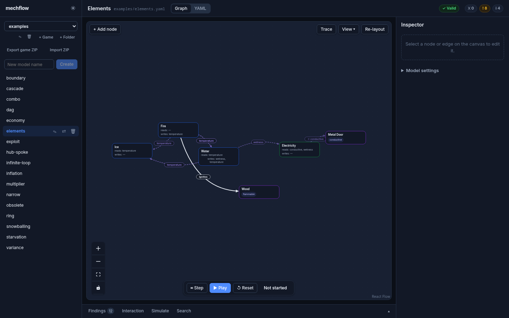
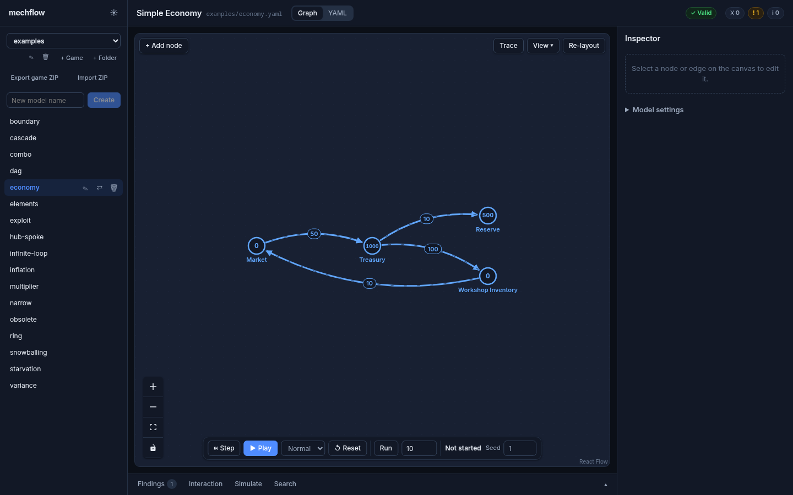

# mechflow

Mechflow is a systems modelling and analysis tool for game designers. You
describe a game economy or a map of interacting mechanics in a YAML file, and
mechflow shows it as a live graph. It finds feedback loops, bottlenecks and
missing interactions, simulates the economy, and searches for the strategies
and combinations that break your balance.

It runs as a local web app, and also as an [MCP](https://modelcontextprotocol.io)
server, so an AI agent can build and analyse the same models you edit in the
browser. Both work on plain YAML files in one folder, and changes from either
side show up in the other within about a second.



## What it does

- **Two kinds of model in one format.** Economy graphs (pools, sources,
  drains, converters, gates) and mechanic maps (mechanics and entities that
  read and write shared properties) live side by side.
- **Static analysis.** Feedback loops, bottlenecks, multipliers, infinite
  loops, coupling between subsystems, an interaction matrix, and _ghost
  edges_: pairs of mechanics that touch the same properties but have no
  interaction yet, so you decide whether they should.
- **Simulation.** Step, play or batch-run an economy with an explicit seed.
  Monte Carlo runs flag inflation, starvation, snowballing, cascading
  failure, high variance and streaks. The semantics are written down in
  [docs/simulation-semantics.md](docs/simulation-semantics.md).
- **Search and stress tests.** Boundary sweeps, dominant combinations, a
  subsystem that makes the others obsolete, a greedy player that hunts for
  exploits, and the size of the viable strategy space. See
  [docs/search-design.md](docs/search-design.md).
- **Agent access.** The MCP server exposes reading, writing, patching,
  analysis, simulation and search as tools. See [docs/mcp.md](docs/mcp.md).



## Quick start

You need Node 22 or later and [pnpm](https://pnpm.io) 9.

```bash
git clone https://github.com/Yalton/mechflow.git
cd mechflow
pnpm install
pnpm -r build
node packages/server/dist/bin.js --models models
```

Open <http://localhost:3000> and pick a model from `models/examples/`.

Server options:

- `--models <dir>` sets the folder of YAML models (default `./models`).
- `--port <n>` sets the port (default 3000).

The server listens on 127.0.0.1 only and has no authentication, so it is
meant for your own machine. It serves `packages/web/dist` relative to the
current directory, so start it from the repository root.

### With Docker

```bash
docker compose up --build
```

This mounts `./models` into the container, so browser saves land in your
files. The port is published on 127.0.0.1 only.

## A model in brief

```yaml
version: 1
name: Campfire
properties:
  - id: temperature
    kind: number
nodes:
  - id: fire
    kind: mechanic
    reads: []
    writes: [temperature]
  - id: wood
    kind: entity
    has: [flammable]
edges:
  - id: fire_to_wood
    kind: interaction
    from: fire
    to: wood
    label: ignites
```

The full field reference is in [docs/mcp.md](docs/mcp.md#model-format-quick-reference),
and `models/examples/` has a model for each analysis.

## Using it with an agent

Build the packages, then register the MCP server with your client. For
Claude Code:

```bash
claude mcp add mechflow -- node /path/to/mechflow/packages/mcp/dist/bin.js --models /path/to/mechflow/models
```

[docs/mcp.md](docs/mcp.md) covers other clients, every tool, and a worked
example of an agent building a mechanic map and resolving its ghost edges.

## Packages

- [`packages/core`](packages/core): model format, formula parser, analysis,
  simulation and search. No UI and no IO beyond YAML parse and serialize.
- [`packages/files`](packages/files): model file IO shared by the server and
  the MCP server (content hashes, compare-and-swap writes).
- [`packages/mcp`](packages/mcp): the stdio MCP server.
- [`packages/server`](packages/server): the local server that serves the web
  app, reads and writes model files, and pushes changes to open tabs.
- [`packages/web`](packages/web): the Vite, React and React Flow browser app.

## Development

```bash
pnpm -r build
pnpm -r typecheck
pnpm -r lint
pnpm -r test
```

For live reload while changing `packages/web`, run the server as above, then
in a second terminal:

```bash
pnpm --filter @mechflow/web dev
```

and open <http://localhost:4173>. The dev server forwards `/api` and `/ws` to
`http://127.0.0.1:3000`; set `MECHFLOW_SERVER_URL` to use another address.

See [CONTRIBUTING.md](CONTRIBUTING.md) before opening a pull request.

## License

[MIT](LICENSE)
